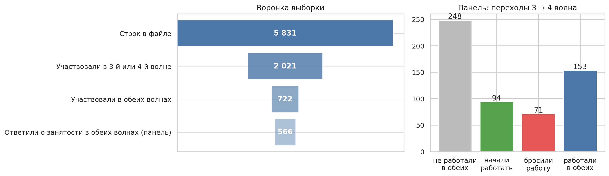
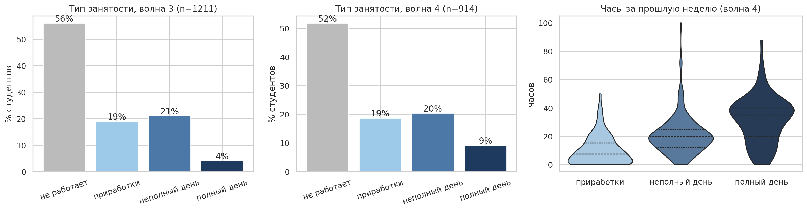
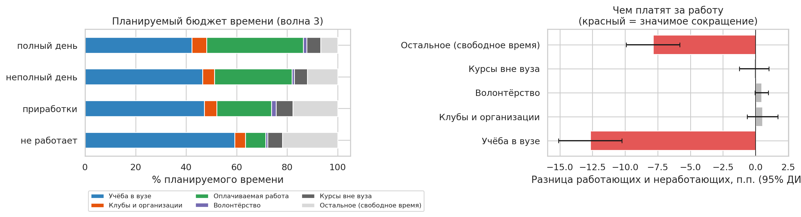
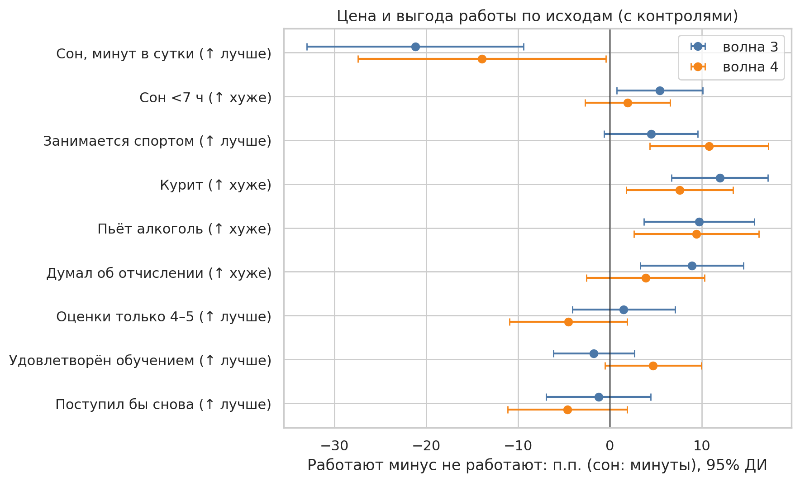
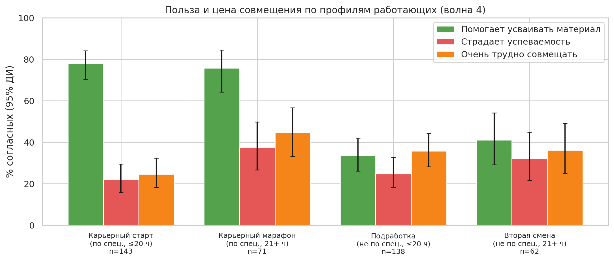

# Анализ влияния совмещения работы с учебой на успеваемость студентов

Исследовательский проект по задаче хакатона ИВО: «Совмещение учёбы и работы: польза или вред?». В проекте анализируется, как занятость студентов связана с их учебным опытом, успеваемостью и самочувствием, и как эти связи различаются по интенсивности, мотиву и соответствию работы специальности.

## Результат

В анализе использованы две волны лонгитюдного исследования «Модели образовательного поведения студентов в их связи с показателями успешности». Ноутбук включает описание выборки и выбытия, сравнение бюджетов времени и исходов, модели среди работающих, переходы между состояниями занятости, профили работающих студентов и проверки устойчивости.

Отмечены такие наблюдаемые закономерности:

- работающие планировали выделять учёбе и отдыху меньшую долю времени;
- самооценка пользы работы для усвоения материала заметно связана с тем, насколько работа соответствует специальности;
- интенсивная занятость чаще связана с ощущением, что работа мешает учёбе и затрудняет совмещение;
- средние различия в успеваемости не дают простого ответа «работа полезна» или «работа вредна».

## Визуализации

Ниже — примеры графиков, собранных в результате анализа для презентации. Остальные графики лежат в [`figs/`](figs/).











## Структура

```text
analysis/work_study_analysis.ipynb  Основной ноутбук
requirements.txt                    Зависимости Python
.gitignore                          Исключения для данных и результатов
```

## Запуск

1. Используйте Python 3.10 или новее.
2. Установите пакеты: `python -m pip install -r requirements.txt`.
3. Получите у организаторов исследования копию массива, которую разрешено использовать для анализа.
4. Положите файл `.sav` в `data/private/longitudinal.sav` или задайте переменную `LONGITUDINAL_DATA` с путём к нему.
5. Запустите все ячейки `analysis/work_study_analysis.ipynb`.

Ноутбук создаёт `figs/` и `results_D.csv` локально. Графики, приложенные к репозиторию, — визуализации из сохранённого результата хакатона; при повторном запуске они будут пересозданы.

## Данные и воспроизводимость

Исходный массив, анкеты/инструментарий и материалы участников хакатона в репозиторий не включены. До публикации проверьте у организаторов условия доступа, цитирования и распространения агрегированных результатов. В частности, не загружайте файл с данными, даже если он обезличен, без явного разрешения владельца исследования.

Рабочая копия ноутбука очищена от сохранённых выводов предыдущих запусков. Поэтому результаты воспроизводятся только при наличии разрешённого исходного массива; без него ячейки не содержат зашитых наблюдений.

## Ограничения

- Это наблюдательное исследование, поэтому коэффициенты не следует интерпретировать как причинный эффект работы.
- Студенты сами выбирают, работать ли им; намерения, финансовая ситуация и другие факторы могут влиять и на занятость, и на учебные исходы.
- Между волнами часть участников выбыла, причём выбытие связано с некоторыми наблюдаемыми характеристиками.
- Самооценка пользы и трудностей измеряет восприятие работающих студентов, а не объективный эффект на обучение.
- Категоризация часов и соответствия специальности упрощает исходные ответы; результаты чувствительны к этим решениям.
- Гипотезы были уточнены после первичного изучения данных, поэтому проверки устойчивости не заменяют независимую репликацию.

## Благодарности

Лонгитюдное исследование «Модели образовательного поведения студентов в их связи с показателями успешности» и организаторам хакатона. Перед публикацией добавьте официальную формулировку цитирования исследования и ссылку на хакатон, если их предоставили организаторы.
